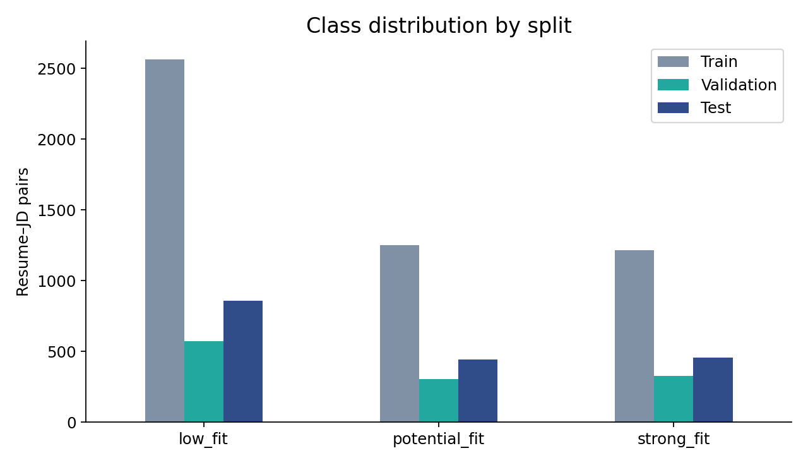
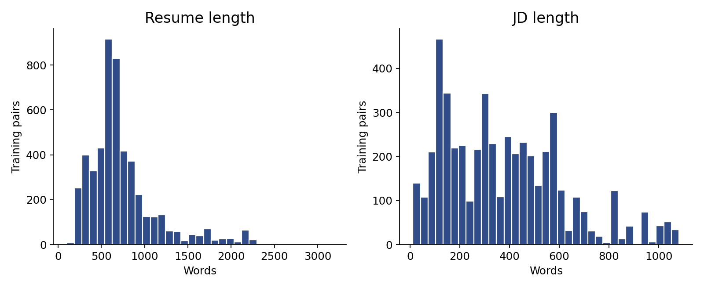

# Dataset audit and preprocessing

Public source: https://huggingface.co/datasets/facehuggerapoorv/resume-jd-match
Snapshot: `bfab7acecac062628b39e0dd0c59e72d675edc9c`. Original brief omits the hyphen in `resume-jd-match`; this correction is intentional.
Frozen input CSV hashes appear in `run_manifest.json`. `scripts/run_capstone.py --download` reloads the pinned public snapshot.
The archived resume text, JD text and label columns were reloaded from the pinned public source and compared exactly: 6,241 train rows and 1,759 test rows match. See `dataset_source_verification.json`.
The upstream dataset card is empty. We cannot establish label-annotation quality, licensing terms for redistribution, or whether examples are synthetic from the card. Keep public-data provenance uncertainty visible.

## Audit results
```json
{
  "original_train": {
"rows": 6241,
"nulls": {
  "candidate_name": 0,
  "job_title": 0,
  "resume_text": 0,
  "jd_text": 0,
  "label": 0
},
"empty_text": {
  "resume_text": 0,
  "jd_text": 0
},
"labels": {
  "low_fit": 3143,
  "potential_fit": 1556,
  "strong_fit": 1542
},
"duplicate_pairs": 7,
"conflicting_pairs": 6,
"unique_jds": 280,
"unique_resumes": 642
  },
  "clean_train_full": {
"rows": 6228,
"nulls": {
  "candidate_name": 0,
  "job_title": 0,
  "resume_text": 0,
  "jd_text": 0,
  "label": 0
},
"empty_text": {
  "resume_text": 0,
  "jd_text": 0
},
"labels": {
  "low_fit": 3136,
  "potential_fit": 1554,
  "strong_fit": 1538
},
"duplicate_pairs": 0,
"conflicting_pairs": 0,
"unique_jds": 280,
"unique_resumes": 642
  },
  "train": {
"rows": 5025,
"nulls": {
  "candidate_name": 0,
  "job_title": 0,
  "resume_text": 0,
  "jd_text": 0,
  "label": 0
},
"empty_text": {
  "resume_text": 0,
  "jd_text": 0
},
"labels": {
  "low_fit": 2563,
  "potential_fit": 1249,
  "strong_fit": 1213
},
"duplicate_pairs": 0,
"conflicting_pairs": 0,
"unique_jds": 224,
"unique_resumes": 634
  },
  "validation": {
"rows": 1203,
"nulls": {
  "candidate_name": 0,
  "job_title": 0,
  "resume_text": 0,
  "jd_text": 0,
  "label": 0
},
"empty_text": {
  "resume_text": 0,
  "jd_text": 0
},
"labels": {
  "low_fit": 573,
  "strong_fit": 325,
  "potential_fit": 305
},
"duplicate_pairs": 0,
"conflicting_pairs": 0,
"unique_jds": 56,
"unique_resumes": 460
  },
  "test": {
"rows": 1759,
"nulls": {
  "candidate_name": 0,
  "job_title": 0,
  "resume_text": 0,
  "jd_text": 0,
  "label": 0
},
"empty_text": {
  "resume_text": 0,
  "jd_text": 0
},
"labels": {
  "low_fit": 857,
  "strong_fit": 458,
  "potential_fit": 444
},
"duplicate_pairs": 0,
"conflicting_pairs": 0,
"unique_jds": 71,
"unique_resumes": 477
  },
  "splits": {
"test_pairs_also_in_training": 0,
"test_jds_also_in_training": 0,
"test_resumes_also_in_training": 1758,
"train_validation_jd_overlap": 0,
"quarantined_rows": 12,
"policy": "Quarantine conflicting normalized pairs in source train only, then deduplicate. Original test remains untouched."
  }
}
```

Required-column and strict combined-prompt validation reject malformed source records. Labels map No Fit / Potential Fit / Good Fit to low_fit / potential_fit / strong_fit.
Preprocessing normalizes whitespace/symbols/case, removes selected boilerplate clauses and explicit demographic/contact fields. Free-form identity, proxy bias, negation and qualification depth remain unresolved.
Conflicting pairs are quarantined using source TRAIN labels only. Exact normalized training duplicates are removed. Test rows and labels remain unchanged.
Development train and validation share no normalized JDs. No normalized JD or exact pair overlaps with the test split.
Resume reuse is substantial; the primary experiment measures transfer to new JDs, not to entirely new people.

## EDA observations
Low-fit is the largest class; accuracy alone can reward majority predictions. Macro F1 weights each class equally and is the configuration-selection metric.
Pair rows reuse a limited pool of resumes and JDs. Grouped validation therefore better reflects the unseen-JD evaluation than a random row split.
Text lengths vary and long inputs exceed the encoder's 256-wordpiece context. Up to eight spaced 150-word chunks improve coverage but can still truncate tokens or omit sections.
Keyword taxonomy emphasizes technology and analytics roles, limiting explanation coverage for other domains.



