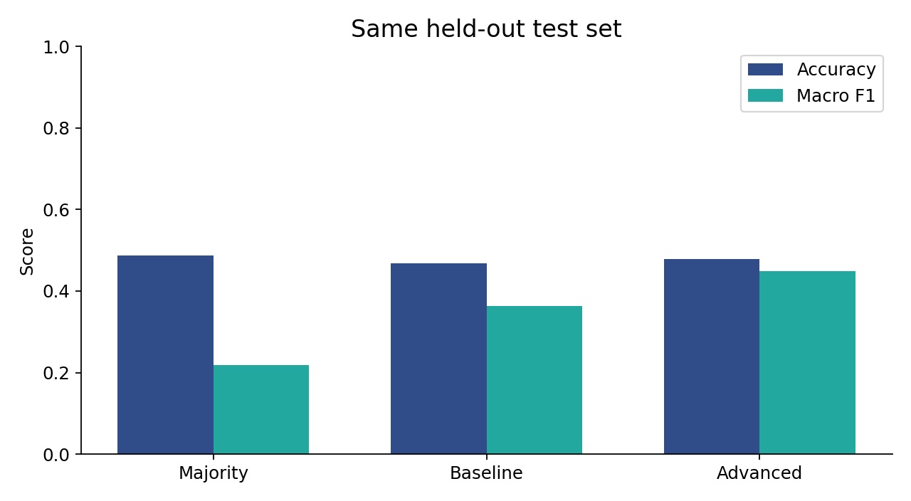
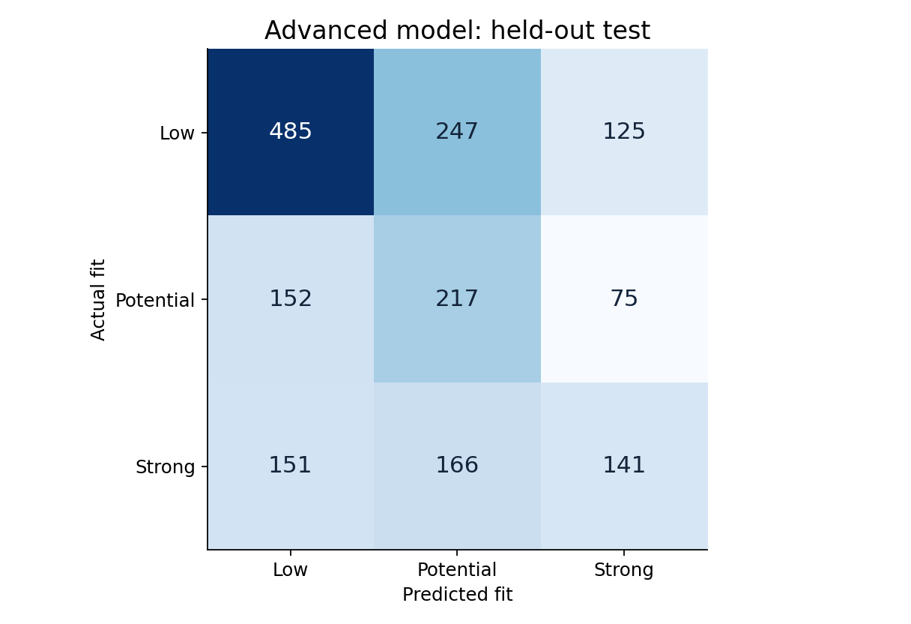
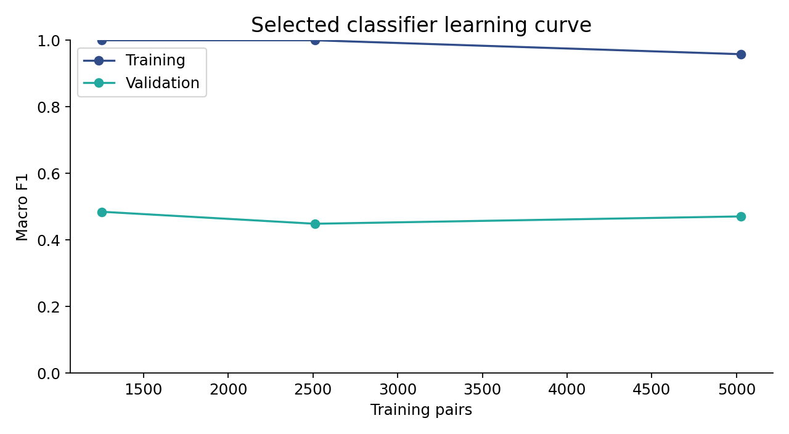

# Model evaluation and error analysis

Presenter: Sanket Toche. Run configuration and hashes: `run_manifest.json`.

## Evaluation protocol
Source train/test snapshot: `facehuggerapoorv/resume-jd-match` at `bfab7acecac062628b39e0dd0c59e72d675edc9c`.
Clean source training pairs: 6228. Development split: 5025 training pairs and 1203 validation pairs, grouped by JD (seed 42).
Select the advanced configuration by validation macro F1, refit on clean source train, then evaluate on all 1759 original test pairs. Test labels never select a configuration.
Selected model: **Sentence-BERT + logistic C1**. Validation macro F1: **0.4732**.
The frozen encoder processes up to eight 150-word chunks per document, normalizes their pooled representation, and produces 384-dimensional vectors. No capstone encoder fine-tuning.

## Test comparison
| Model | Accuracy | Macro F1 | Weighted F1 | NDCG@3 | Precision@3 |
|---|---:|---:|---:|---:|---:|
| Majority | 0.4872 | 0.2184 | 0.3192 | 0.4983 | 0.2147 |
| Baseline | 0.4673 | 0.3626 | 0.4200 | 0.6150 | 0.2896 |
| Advanced | 0.4792 | 0.4489 | 0.4812 | 0.6910 | 0.3060 |

Advanced minus TF-IDF baseline macro F1: **+0.0863**. These are observed point estimates, not a significance claim.
Ranking metrics average over 61 eligible JD groups. Macro over JD groups with >=2 candidates and at least one non-low fit; NDCG relevance 0/1/2; Precision@3 relevant=strong_fit; tie-aware.
Evaluation and deployment share a composite ranking score: 30% expected fit, 45% clipped embedding cosine (lexical cosine for the baseline) and 25% keyword skill overlap. This fixed engineering ranking rule is not fitted to test labels. It is not a calibrated hiring probability.
Classifier categories remain separate diagnostics and can disagree with rank. This separation is explicit in the UI; categories are not manually relabeled to match the score.

## Advanced model by class
| Actual class | Precision | Recall | F1 | Support |
|---|---:|---:|---:|---:|
| low_fit | 0.6155 | 0.5659 | 0.5897 | 857 |
| potential_fit | 0.3444 | 0.4887 | 0.4041 | 444 |
| strong_fit | 0.4135 | 0.3079 | 0.3529 | 458 |

## Representative sample predictions
| Candidate | Actual | Predicted | Priority |
|---|---|---|---:|
| HF Candidate 1 | low_fit | potential_fit | 42.94 |
| HF Candidate 2 | low_fit | low_fit | 34.70 |
| HF Candidate 858 | potential_fit | low_fit | 24.24 |
| HF Candidate 859 | potential_fit | potential_fit | 56.76 |
| HF Candidate 1302 | strong_fit | strong_fit | 68.85 |
| HF Candidate 1303 | strong_fit | low_fit | 29.10 |

## Actual test errors
| Candidate | Actual | Predicted | Priority |
|---|---|---|---:|
| HF Candidate 1 | low_fit | potential_fit | 42.94 |
| HF Candidate 3 | low_fit | strong_fit | 49.67 |
| HF Candidate 858 | potential_fit | low_fit | 24.24 |
| HF Candidate 861 | potential_fit | low_fit | 15.04 |
| HF Candidate 1303 | strong_fit | low_fit | 29.10 |
| HF Candidate 1304 | strong_fit | potential_fit | 57.65 |

Every row is traceable to `advanced_test_predictions.csv` and the original test CSV. These examples are selected after evaluation to illustrate errors, not used for tuning.
All source records currently have a generic job-title field, so reliable job-family segment metrics cannot be claimed.

## Learning curve and experiments

Full configurations, validation metrics and elapsed training time are in `experiments/experiments.json` and `.csv`.
The curve varies classifier training-set size on one fixed JD-grouped validation split. Encoder weights stay frozen, so optimizer/learning-rate/epoch tuning of the transformer is not claimed.
The full-size learning-curve point has training macro F1 0.9582 versus validation macro F1 0.4707. This large gap and the non-monotonic validation curve show overfitting/instability. More labeled data, stronger regularization and grouped cross-validation are future work, not completed claims.

## Latency
Loaded-encoder CPU inference, 20 pairs, no per-document cache reuse: median **962.0 ms**, p95 **1740.0 ms**.
Includes embedding generation and skill suggestions. Excludes process/model loading, HTTP/network and concurrent load. Hardware: AMD64 Family 25 Model 80 Stepping 0, AuthenticAMD. Python 3.11.9.

## Explanation review and fairness checks
Three deterministic keyword fixtures check expected matched/missing lists. Twelve controlled demographic-field variants across three demo resumes check prediction invariance after redaction.
Results: `responsible_use_checks.json`. This is a small regression audit, not a fairness certification. Protected-group outcome metrics cannot be inferred without suitable group labels and consent.
Embedding suggestions show possible paraphrases as unverified evidence; keyword matches and skill proficiency remain distinct.

## Known failure and intended use
The keyword-only demo produces `potential_fit` with priority 75.51; it still detects 8 matching keyword skills despite explicit lack of experience.
The very short new-input examples can receive overconfident or incorrect categories despite different relevance. The composite ranking adds semantic/skill evidence, but does not repair category validity. The app displays short-input and prediction/similarity-conflict warnings.
This is a reproducible explanation failure. Negation, keyword stuffing, experience depth and false negatives require manual review.
Most test resumes (1758/1759 pairs) also occur in clean training, although test JDs and exact pairs do not. Unseen-candidate generalization remains unproven.
Dataset card/provenance and synthetic-data status are uncertain. Boilerplate filtering and explicit-field redaction are limited mitigations.
Use this capstone for a supervised recruiter demonstration. It is not sufficient evidence for autonomous hiring, rejection or production deployment.
